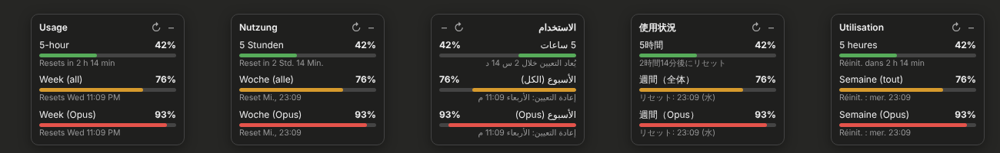
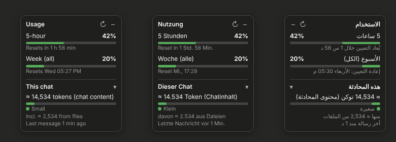

# Usage Meter for Claude

[English](README.md) | **Deutsch**

Eine kleine, inoffizielle Chrome-Erweiterung, die auf **claude.ai** dein aktuelles Nutzungslimit anzeigt – direkt auf der Seite, ohne in die Einstellungen wechseln zu müssen – plus eine grobe Größenschätzung des gerade geöffneten Chats.



> ⚠️ **Inoffiziell.** Dieses Projekt ist nicht mit Anthropic verbunden und wird nicht von Anthropic unterstützt. „Claude“ ist eine Marke von Anthropic.

## Was es anzeigt

- **5-Stunden-Limit** – wie viel deines aktuellen Sitzungsfensters verbraucht ist und wann es zurückgesetzt wird
- **Wochenlimit** – gesamt sowie (falls vorhanden) getrennt für Opus und Sonnet
- Farbige Balken: grün (< 70 %), gelb (70–89 %), rot (≥ 90 %)
- Aktualisiert sich automatisch jede Minute
- **Dieser Chat** – grobe Größe des gerade geöffneten Chats und wann die letzte Nachricht war (siehe unten)

## Dieser Chat

Jede neue Nachricht lässt Claude den **ganzen bisherigen Chat** noch einmal verarbeiten. Je länger ein Chat, desto mehr verbraucht jede weitere Frage von deinem Limit. Der Abschnitt „Dieser Chat“ zeigt dir, wann es Zeit für einen neuen Chat ist:

- **≈ Token (Chatinhalt)** mit Ampel: 🟢 klein (< 40.000) · 🟡 groß · 🔴 sehr groß (ab 120.000) – neuer Chat empfohlen
- **davon aus Dateien**: geschätzter Anteil von Bildern, PDFs und angehängten Texten
- **Letzte Nachricht vor X Min.** – nach über 60 Minuten Pause ein Hinweis, dass ein neuer Chat evtl. günstiger ist



**Wann wird gezählt?** Nicht ständig: nur, nachdem sich im Chat etwas geändert hat (also nach einer Antwort) – und dann nur die neuen Nachrichten. Das Ergebnis wird pro Chat lokal im Browser gespeichert und beim nächsten Öffnen sofort angezeigt. Ändert sich nichts, werden die Abstände zwischen den Prüfungen immer länger (bis 5 Minuten).

**Was bedeutet die Zahl?** Sie ist der **gesamte Chatinhalt**: alles, was je im Chat war – Text, Werkzeug-Ergebnisse und Dateien –, auch wenn das mehr als eine Million Token sind. Bei sehr langen Chats fasst Claude ältere Teile automatisch zusammen und liest dann **pro Nachricht weniger**, als die Zahl zeigt. Die Zahl selbst wird nicht gekürzt, damit du immer siehst, wie groß der Chat wirklich ist.

**Wie genau ist das?** Es ist eine **Schätzung**, gut als Trend („dieser Chat wird groß“), nicht als exakte Zahl:

- Claudes Tokenizer ist nicht öffentlich – gezählt wird über Zeichen (Abweichung etwa ±10–20 %).
- **Nicht enthalten:** Claudes Systemanweisungen und Werkzeuge, Projektdokumente, Memory. Diese setzt claude.ai auf dem Server zusammen; der Browser bekommt sie nicht zu sehen.
- Bilder werden nach Anthropics Faustformel (Breite × Höhe ÷ 750) geschätzt, PDFs mit ca. 2.000 Token pro Seite.
- claude.ai schickt keine echten Tokenzahlen an den Browser (geprüft im November 2026), deshalb geht es nicht genauer.

Der Abschnitt lässt sich mit einem Klick auf seine Überschrift ein- und ausklappen.

## Sprachen

Die Erweiterung übernimmt automatisch die **Sprache deines Browsers** (die in der Regel der Systemsprache entspricht). Enthalten sind:

Englisch, Deutsch, Französisch, Spanisch, Italienisch, Portugiesisch (Brasilien), Niederländisch, Polnisch, Türkisch, Arabisch (von rechts nach links), Russisch, Japanisch, Chinesisch (vereinfacht) und Koreanisch.

Für alle anderen Sprachen wird Englisch angezeigt. Neue Sprachen lassen sich einfach ergänzen: Ordner unter `extension/_locales/` kopieren und die Texte in `messages.json` übersetzen. Gezählt werden Chats in jeder Sprache.

## Systeme

Funktioniert auf **Windows, macOS, Linux und ChromeOS** – in Google Chrome und anderen Chromium-Browsern wie **Microsoft Edge, Brave, Opera, Vivaldi oder Arc**. Firefox und Safari werden nicht unterstützt.

## Bedienung

| Aktion | Wie |
|---|---|
| Ausblenden | Auf **–** klicken → es bleibt nur ein kleiner Kreis mit der 5-Stunden-Prozentzahl |
| Einblenden | Auf den Kreis klicken |
| Umschalten per Tastatur | **Alt + U** (Windows/Linux) bzw. **⌥ + U** (Mac) |
| Verschieben | An der Titelzeile ziehen |
| Sofort aktualisieren | Auf **↻** klicken |

Position und Ein-/Ausblend-Zustand werden gespeichert.

## Installation

**Empfohlen (mit Git – spätere Updates mit einem Befehl):**

```
cd ~/Documents
git clone https://github.com/obadaobaid/usage-meter-for-claude.git
```

(Windows: im Terminal/PowerShell z. B. `cd $HOME\Documents` statt `cd ~/Documents`.)

**Ohne Git:** grüner Button **Code → Download ZIP** und entpacken.

Dann in Chrome:

1. `chrome://extensions` öffnen.
2. Oben rechts den **Entwicklermodus** einschalten.
3. **„Entpackte Erweiterung laden“** klicken und den Ordner `usage-meter-for-claude/extension` auswählen.
4. claude.ai neu laden.

## Aktualisieren

**Mit Git:**

```
cd ~/Documents/usage-meter-for-claude
git pull
```

(Wer das Projekt noch unter dem alten Namen `claude-usage-anzeige` geklont hat: einfach in diesem Ordner `git pull` ausführen – GitHub leitet automatisch weiter.)

Danach in `chrome://extensions` bei der Erweiterung auf **↻ (Neu laden)** klicken und **jeden offenen claude.ai-Tab neu laden** (⌘ + R bzw. Strg + R). Bis dahin blendet sich das Kästchen in alten Tabs aus. Position und Einstellungen bleiben erhalten.

Ohne Terminal geht das auch mit der kostenlosen App **GitHub Desktop** (Button „Pull origin“).

**Ohne Git:** neue ZIP herunterladen, den Inhalt des bisherigen Ordners damit ersetzen (Ordner am selben Ort lassen) und in `chrome://extensions` auf **↻** klicken.

## Datenschutz

- Die Erweiterung läuft **nur auf claude.ai**.
- Sie liest ausschließlich deine eigenen Nutzungsdaten – über dieselbe Schnittstelle, die auch die Nutzungsseite in den claude.ai-Einstellungen verwendet.
- Für „Dieser Chat“ liest sie den geöffneten Chat (wie die claude.ai-Seite selbst) und zählt die Zeichen **lokal in deinem Browser**. Gespeichert werden nur Zahlen und Nachrichten-IDs, **keine Chatinhalte** (höchstens die letzten 200 Chats).
- Es werden **keine Daten an fremde Server** gesendet, es gibt kein Tracking.
- Außerdem gespeichert: ob das Kästchen ein- oder ausgeblendet ist und wo es steht.

## Bekannte Einschränkungen

Die Erweiterung nutzt eine **interne, nicht dokumentierte** Schnittstelle von claude.ai. Wenn Anthropic diese ändert, zeigt das Kästchen eine Fehlermeldung („Nutzung konnte nicht geladen werden“). In dem Fall gern ein Issue öffnen.

## Lizenz

[MIT](LICENSE)
