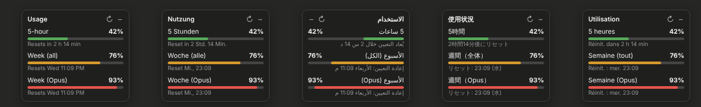

# Usage Meter for Claude

Eine kleine, inoffizielle Chrome-Erweiterung, die auf **claude.ai** dein aktuelles Nutzungslimit anzeigt – direkt auf der Seite, ohne in die Einstellungen wechseln zu müssen.

> ⚠️ **Inoffiziell.** Dieses Projekt ist nicht mit Anthropic verbunden und wird nicht von Anthropic unterstützt. „Claude“ ist eine Marke von Anthropic.

## Was es anzeigt

- **5-Stunden-Limit** – wie viel deines aktuellen Sitzungsfensters verbraucht ist und wann es zurückgesetzt wird
- **Wochenlimit** – gesamt sowie (falls vorhanden) getrennt für Opus und Sonnet
- Farbige Balken: grün (< 70 %), gelb (70–89 %), rot (≥ 90 %)
- Aktualisiert sich automatisch jede Minute

## Sprachen

Die Erweiterung übernimmt automatisch die **Sprache deines Browsers** (die in der Regel der Systemsprache entspricht). Enthalten sind:

Englisch, Deutsch, Französisch, Spanisch, Italienisch, Portugiesisch (Brasilien), Niederländisch, Polnisch, Türkisch, Arabisch (von rechts nach links), Russisch, Japanisch, Chinesisch (vereinfacht) und Koreanisch.

Für alle anderen Sprachen wird Englisch angezeigt. Neue Sprachen lassen sich einfach ergänzen: Ordner unter `extension/_locales/` kopieren und die Texte in `messages.json` übersetzen.

## Systeme

Funktioniert auf **Windows, macOS, Linux und ChromeOS** – in Google Chrome und anderen Chromium-Browsern wie **Microsoft Edge, Brave, Opera, Vivaldi oder Arc**. Firefox und Safari werden nicht unterstützt.

## Bedienung

| Aktion | Wie |
|---|---|
| Ausblenden | Auf **–** klicken → es bleibt nur ein kleiner Kreis mit der 5-Stunden-Prozentzahl |
| Einblenden | Auf den Kreis klicken |
| Umschalten per Tastatur | **Alt + U** (Windows/Linux) bzw. **⌥ + U** (Mac) |
| Verschieben | An der Titelzeile ziehen |
| Sofort aktualisieren | Auf **↻** klicken |

Position und Ein-/Ausblend-Zustand werden gespeichert.

## Installation

1. Dieses Repository herunterladen: grüner Button **Code → Download ZIP**, dann entpacken.
2. In Chrome `chrome://extensions` öffnen.
3. Oben rechts den **Entwicklermodus** einschalten.
4. **„Entpackte Erweiterung laden“** klicken und den Ordner `extension` auswählen.
5. claude.ai neu laden.

## Datenschutz

- Die Erweiterung läuft **nur auf claude.ai**.
- Sie liest ausschließlich deine eigenen Nutzungsdaten – über dieselbe Schnittstelle, die auch die Nutzungsseite in den claude.ai-Einstellungen verwendet.
- Es werden **keine Daten an fremde Server** gesendet, es gibt kein Tracking.
- Gespeichert wird lokal nur, ob das Kästchen ein- oder ausgeblendet ist und wo es steht.

## Bekannte Einschränkungen

Die Erweiterung nutzt eine **interne, nicht dokumentierte** Schnittstelle von claude.ai. Wenn Anthropic diese ändert, zeigt das Kästchen eine Fehlermeldung („Nutzung konnte nicht geladen werden“). In dem Fall gern ein Issue öffnen.

---

## English (short)

Unofficial Chrome extension that shows your **5-hour session limit** and **weekly limit** as a small, draggable, hideable overlay on claude.ai. Press **Alt + U** (Windows/Linux) or **⌥ + U** (Mac) to toggle.

- **Languages:** follows your browser/system language automatically – English, German, French, Spanish, Italian, Portuguese (BR), Dutch, Polish, Turkish, Arabic, Russian, Japanese, Chinese (Simplified), Korean. Falls back to English.
- **Platforms:** Windows, macOS, Linux, ChromeOS – Chrome and other Chromium browsers (Edge, Brave, Opera, Vivaldi, Arc).
 Install via `chrome://extensions` → Developer mode → *Load unpacked* → select the `extension` folder. No data leaves your browser except requests to claude.ai itself. Not affiliated with Anthropic.

## Lizenz

[MIT](LICENSE)
