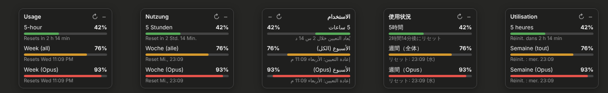
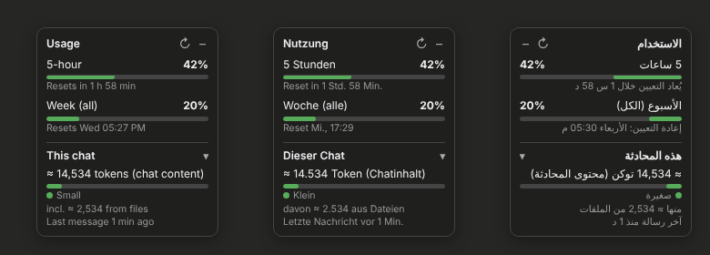

# Usage Meter for Claude

**English** | [Deutsch](README.de.md)

A small, unofficial Chrome extension that shows your current **usage limits on claude.ai** right on the page – no need to open the settings – plus a rough size estimate of the chat you have open.



> ⚠️ **Unofficial.** This project is not affiliated with or endorsed by Anthropic. "Claude" is a trademark of Anthropic.

## What it shows

- **5-hour limit** – how much of your current session window is used and when it resets
- **Weekly limit** – overall, plus Opus and Sonnet separately where your plan has them
- Colored bars: green (< 70 %), yellow (70–89 %), red (≥ 90 %)
- Refreshes automatically every minute
- **This chat** – rough size of the chat that is open and when the last message was (see below)

## This chat

With every new message, Claude processes the **whole conversation so far** again. The longer a chat gets, the more of your limit each further question uses. The "This chat" section helps you see when it is time to start a new chat:

- **≈ tokens (chat content)** with a traffic light: 🟢 small (< 40,000) · 🟡 large · 🔴 very large (from 120,000) – new chat recommended
- **incl. from files** – estimated share of images, PDFs and attached texts
- **Last message x min ago** – after a break of more than 60 minutes, a hint that a new chat may be cheaper



**When is it counted?** Not constantly: only after something changed in the chat (i.e. after a reply), and then only the new messages. The result is stored locally in your browser per chat and shown immediately the next time you open it. If nothing changes, the checks get further and further apart (up to 5 minutes).

**What does the number mean?** It is the **total content of the chat**: everything that has ever been in it – text, tool results and files – even if that is more than a million tokens. In very long chats, Claude automatically summarizes older parts and then reads **less per message** than the number shows. The number itself is not cut off, so you always see how big the chat really is.

**How accurate is it?** It is an **estimate**, good for the trend ("this chat is getting big"), not an exact figure:

- Claude's tokenizer is not public – the count is based on characters (roughly ±10–20 %).
- **Not included:** Claude's system instructions and tools, project documents, memory. claude.ai assembles these on its servers; the browser never sees them.
- Images are estimated with Anthropic's rule of thumb (width × height ÷ 750), PDFs with about 2,000 tokens per page.
- claude.ai does not send real token counts to the browser (checked in November 2026), so more accuracy is not possible.

Click the section heading to collapse or expand it.

## Languages

The extension automatically follows **your browser's language** (usually the same as your system language). Included:

English, German, French, Spanish, Italian, Portuguese (Brazil), Dutch, Polish, Turkish, Arabic (right-to-left), Russian, Japanese, Chinese (Simplified) and Korean.

All other languages fall back to English. Adding a language is easy: copy a folder in `extension/_locales/` and translate the texts in `messages.json`. Chats in any language are counted.

## Platforms

Works on **Windows, macOS, Linux and ChromeOS** – in Google Chrome and other Chromium browsers such as **Microsoft Edge, Brave, Opera, Vivaldi or Arc**. Firefox and Safari are not supported.

## How to use

| Action | How |
|---|---|
| Hide | Click **–** → only a small circle with the 5-hour percentage remains |
| Show | Click the circle |
| Toggle with keyboard | **Alt + U** (Windows/Linux) or **⌥ + U** (Mac) |
| Move | Drag the title bar |
| Refresh now | Click **↻** |

Position and visibility are remembered.

## Installation

**Recommended (with Git – later updates with one command):**

```
cd ~/Documents
git clone https://github.com/obadaobaid/usage-meter-for-claude.git
```

(Windows: in Terminal/PowerShell use e.g. `cd $HOME\Documents` instead of `cd ~/Documents`.)

**Without Git:** green button **Code → Download ZIP**, then unzip.

Then in Chrome:

1. Open `chrome://extensions`.
2. Turn on **Developer mode** (top right).
3. Click **"Load unpacked"** and select the folder `usage-meter-for-claude/extension`.
4. Reload claude.ai.

## Updating

**With Git:**

```
cd ~/Documents/usage-meter-for-claude
git pull
```

(If you cloned the project under its old name `claude-usage-anzeige`, just run `git pull` in that folder – GitHub redirects automatically.)

Then click **↻ (Reload)** on the extension in `chrome://extensions` and **reload every open claude.ai tab** (⌘ + R or Ctrl + R). Until then the box hides itself in old tabs. Position and settings are kept.

Without a terminal you can use the free **GitHub Desktop** app (button "Pull origin").

**Without Git:** download the new ZIP, replace the contents of your existing folder (keep the folder in the same place) and click **↻** in `chrome://extensions`.

## Privacy

- The extension runs **only on claude.ai**.
- It only reads your own usage data – through the same interface the usage page in claude.ai's settings uses.
- For "This chat" it reads the open chat (like the claude.ai page itself) and counts the characters **locally in your browser**. Only numbers and message IDs are stored, **no chat content** (at most the last 200 chats).
- **No data is sent to any third-party server**, there is no tracking.
- Also stored: whether the box is hidden and where it is placed.

## Known limitations

The extension uses an **internal, undocumented** claude.ai interface. If Anthropic changes it, the box shows an error message ("Couldn't load usage"). In that case, please open an issue.

## License

[MIT](LICENSE)
